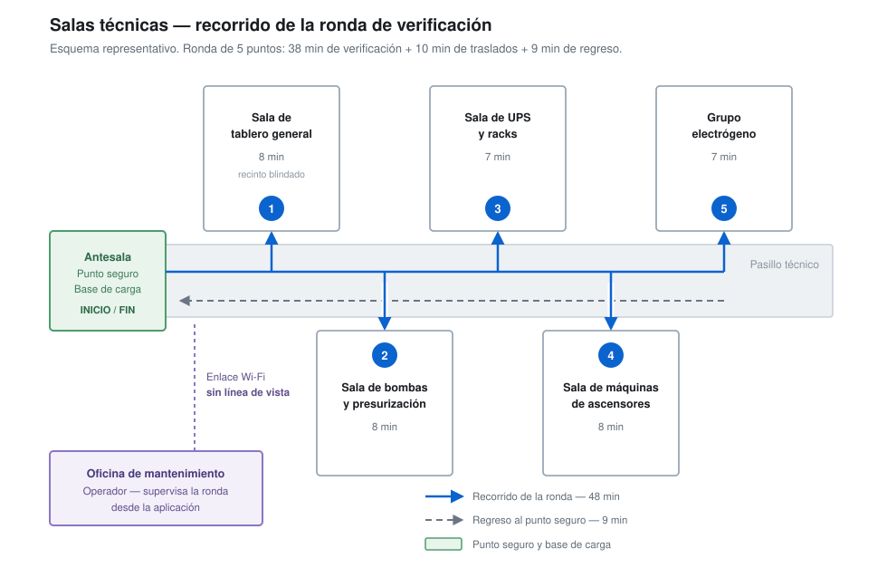

# Interfaz HMI/HRI para verificación previa de salas técnicas con Unitree G1

**Preentrega — Desarrollo de Aplicaciones I** 
Facultad de Ingeniería y Ciencias Exactas — UADE 
Fabricio Boccardo 
20 de noviembre de 2026

---

## 1. El caso de uso

### 1.1 El problema

Antes de que la cuadrilla de mantenimiento intervenga un tablero eléctrico o una sala de máquinas del edificio, alguien tiene que entrar primero a verificar las condiciones del recinto: ausencia de tensión, temperatura de barras y borneras, estado de instrumentos, presencia de humo u olor a quemado, y que no haya obstáculos ni daños visibles.

### 1.2 Cómo se resuelve hoy

Un técnico de mantenimiento entra con equipo de protección personal a hacer esa verificación a mano. Queda expuesto a:

- **Arco eléctrico**, que es la contingencia grave: puede ser fatal y ocurre justamente en el momento de abrir o accionar.
- Atmósferas calientes o con productos de combustión.
- Espacios confinados con poca ventilación.

Además, la verificación depende de la atención de una persona al final de un turno y no deja registro estructurado: queda en una planilla en papel o en la memoria del técnico.

### 1.3 La propuesta

El Unitree G1 entra primero. Recorre los cinco puntos de verificación de una ronda, toma lecturas, acciona lo que haga falta bajo autorización explícita, y devuelve un informe de condiciones. La cuadrilla entra después, sabiendo qué va a encontrar. Un operador supervisa la ronda a distancia desde la aplicación, sin línea de vista al robot.

### 1.4 Por qué un robot y no el procedimiento actual

El costo del equipo (USD 60.000 aproximados) se compara contra la exposición de una persona a un evento de arco eléctrico, que es un riesgo de consecuencia catastrófica y baja probabilidad.

El robot no elimina la necesidad de la cuadrilla. **Elimina la exposición en el momento de mayor riesgo**, que es la verificación a ciegas de un recinto cuyo estado se desconoce. Como beneficio secundario, cada ronda deja un registro estructurado y con marca de tiempo que hoy no existe.

### 1.5 Por qué el G1 y no el Go2

El cuadrúpedo no tiene manos. En este servicio hay que:

- Abrir puertas de tablero y accionar llaves y seccionadores, que son controles diseñados para manos humanas.
- Leer instrumentos analógicos montados a la altura del rostro de una persona de pie.

La altura de 1,32 m del G1 coincide con la franja de montaje de instrumentos y mandos de un tablero. El argumento central es que **el G1 interactúa con infraestructura diseñada para humanos**, que es exactamente lo que un cuadrúpedo o un robot con ruedas no puede hacer.

---

## 2. La plataforma: Unitree G1 EDU

### 2.1 Datos técnicos

| Característica | Valor |
|---|---|
| Peso | 35 kg |
| Altura | 1,32 m |
| Velocidad máxima | 2 m/s |
| Articulaciones | Más de 35 |
| Capacidad de carga | 5 kg por brazo |
| Autonomía | 2 h 30 min a 3 h según uso |
| Tiempo de carga | 1 h 30 min |
| Costo aproximado | USD 60.000 |

### 2.2 Capacidades disponibles de fábrica

- **Mapeo 3D por lidar.** Genera un mapa del entorno. Mira hacia abajo en un cono triangular; lo que queda alrededor se representa como mapa de calor.
- **Arreglo de micrófonos.** Varios micrófonos agrupados que permiten ubicar la dirección de origen de un sonido.
- **Sensor inercial de equilibrio.** Giroscopio y acelerómetro que revisan la postura muchas veces por segundo.
- **Manos con sensor en la palma**, con 5 kg de capacidad por brazo.
- **Arquitectura de dos cómputos:** una parte blindada por el fabricante y una parte abierta a programación.
- **Integración con asistentes de IA.** En la demostración observada estaba integrado con Otto, el asistente de UADE.

### 2.3 Restricciones relevantes para este caso

Estas limitaciones no son defectos a ocultar: son el fundamento del diseño de seguridad de la interfaz.

- **No cuenta con corte físico de emergencia (kill-switch).** Es la restricción que domina todo el diseño.
- **La estabilidad es su punto débil.** Pisa con fuerza y, en modo manual, la teleoperación no consulta sus sensores de entorno.
- **Zona ciega perimetral.** El cono de visión apunta hacia abajo; el entorno lateral y trasero se representa como mapa de calor y no como detección confiable.
- **No actúa por iniciativa propia.** Necesita un objetivo dado. Reconoce patrones aprendidos de datos; no comprende la situación como una persona. Lo que se percibe como personalidad es diseño de interacción, no estado emocional.
- **Autonomía acotada.** Entre 2 h 30 min y 3 h, con 1 h 30 min de recarga, lo que obliga a planificar la ronda y el regreso.

### 2.4 Capacidades que requerirían equipamiento o desarrollo adicional

Se distingue de forma explícita lo que el robot hace de fábrica de lo que habría que construir:

| Capacidad necesaria | Estado |
|---|---|
| Medición de temperatura de tableros | Requiere **cámara térmica** adicional; no viene de fábrica |
| Detección de humo, CO o gases | Requiere sensores adicionales |
| Lectura de instrumentos analógicos | Requiere visión por computadora entrenada para este caso |
| Accionamiento de seccionadores | Requiere herramienta específica, validación de torque y certificación eléctrica |
| Corte físico de emergencia | **No existe**; requiere desarrollo o un dispositivo externo |
| Navegación autónoma robusta en sala técnica | El lidar mapea, pero la navegación confiable sin GPS en estos recintos requiere desarrollo |
| Operación en ambiente con polvo o calor elevado | Grado de protección no garantizado para el recinto |

La variable de temperatura del servicio depende de equipamiento adicional, y así se declara en la interfaz.

### 2.5 Decisión de diseño: sin joystick

**La aplicación no ofrece control manual continuo.** La razón no es simplificar: en modo manual el G1 no consulta sus sensores de entorno, de modo que un joystick remoto operado por alguien sin línea de vista convierte al operador en la única barrera contra una colisión, con 35 kg a 2 m/s y una zona ciega perimetral.

Todo el control es por **órdenes discretas**, que es lo que el enunciado permite expresamente.

---

## 3. Entorno y recorrido

### 3.1 Ubicación

Pasillo de salas técnicas del edificio de UADE. El operador trabaja desde la oficina de mantenimiento, en otro piso, **sin línea de vista** al robot.

### 3.2 Esquema del recorrido

*Esquema representativo de la disposición de las salas y del orden de la ronda. Las dimensiones y la posición relativa se confirman con el relevamiento en sitio.*

### 3.3 Ronda de verificación

| # | Punto | Qué verifica | Tiempo |
|---|---|---|---|
| P1 | Sala de tablero general | Ausencia de tensión, temperatura de barras, olor a quemado | 8 min |
| P2 | Sala de bombas y presurización | Estado de bombas, temperatura, pérdidas | 8 min |
| P3 | Sala de UPS y racks | Temperatura, estado de baterías, ventilación | 7 min |
| P4 | Sala de máquinas de ascensores | Temperatura, estado de maniobra | 8 min |
| P5 | Grupo electrógeno | Nivel de combustible, temperatura, estado de arranque | 7 min |

Con 2 minutos de traslado entre puntos, la ronda completa demanda **48 minutos**, más **9 minutos** de regreso. Sobre una autonomía de 150 minutos, el margen es amplio, pero la aplicación igual verifica la relación antes de permitir el inicio.

### 3.4 Punto seguro

Antesala del pasillo técnico, donde está la base de carga. Es el destino del comando de regreso y del regreso autónomo por pérdida de enlace prolongada.

---

## 4. Actores y roles

| Actor | Usa la app | Qué necesita |
|---|---|---|
| **Operador de mantenimiento** | Sí, es el único usuario | Estado del robot y de la ronda, alertas, capacidad de intervenir |
| **Supervisor de mantenimiento** | No directamente | Autoriza las órdenes críticas mediante código; queda registrado nominalmente |
| **Cuadrilla de mantenimiento** | No | El informe de condiciones antes de entrar |
| **Acompañante presencial** | No | Está en el sitio con autoridad para intervenir físicamente y cortar la alimentación de la sala |
| **Terceros** (alumnos, personal de limpieza) | No | Señalización y previsibilidad del movimiento del robot |

### 4.1 La interacción con las personas presentes (HRI)

El robot recorre pasillos de una facultad, así que la interacción no se limita al operador:

- **Señalización y previsibilidad.** Cartelería en el acceso al pasillo técnico durante la ronda, y ventana horaria sin actividad académica.
- **El robot cede el paso.** Al detectar presencia el avance se bloquea y la reanudación queda a cargo del operador, no del robot.
- **Indicador de registro.** La interfaz muestra qué se está registrando en cada momento, porque el equipo lleva lidar y micrófonos por un edificio con gente.
- **El acompañante presencial** es la vía de intervención física cuando la aplicación ya no alcanza.

### 4.2 Cuándo debe intervenir un humano

1. Cuando un punto de verificación da resultado de falla: el robot no decide, se detiene y espera.
2. Cuando una orden crítica requiere autorización de supervisor.
3. Cuando la batería no alcanza para completar la ronda y el regreso.
4. Cuando se detecta presencia en el entorno y el avance queda bloqueado.
5. Cuando una orden de detención no se verifica como ejecutada: ahí interviene el acompañante presencial, porque la aplicación ya no alcanza.

---

## 5. Modelo de misión

### 5.1 Estructura

La misión es una **ronda ordenada de puntos de verificación**. En cada punto el robot toma lecturas y produce un resultado: `OK`, `OBSERVACION` o `FALLA`. El progreso es puntos completados sobre el total.

### 5.2 Subproceso de anomalía

Cuando un punto da `FALLA`, el robot se detiene y la aplicación exige una decisión del operador entre tres caminos:

1. **Marcar y continuar** — se registra la falla y la ronda sigue con el punto siguiente.
2. **Aislar** — se solicita accionar el seccionador, lo que exige autorización de supervisor.
3. **Abortar y regresar** — la ronda se cierra como incompleta y el robot vuelve al punto seguro.

Sin decisión del operador el robot no avanza. Este subproceso es el que da lugar al flujo con falla del prototipo.

### 5.3 Consecuencia operativa de una ronda incompleta

Si la ronda no se completa, **la cuadrilla no puede entrar**. El historial registra qué puntos quedaron sin verificar. Esto le da peso real a los comandos de cancelación y de regreso: no son botones decorativos, cancelan un permiso de trabajo.

### 5.4 Estados operativos

`EN_ESPERA`, `EN_TRASLADO`, `VERIFICANDO_PUNTO`, `ESPERANDO_DECISION`, `PAUSADO`, `DETENIDO`, `RETORNANDO`, `EN_FALLA`

---

## 6. Telemetría

### 6.1 Las ocho obligatorias

| Dato | Representación en este caso |
|---|---|
| Conectividad | Estado del enlace (`OK`, `DEGRADADO`, `PERDIDO`) y latencia en ms |
| Batería | Porcentaje y autonomía estimada restante en minutos |
| Estado operativo | Uno de los ocho estados de la sección anterior |
| Misión y progreso | Ronda activa, punto actual, completados sobre total |
| Ubicación | Sala y punto de verificación actual |
| Movimiento | Velocidad en m/s y bandera de caminando |
| Alertas | Lista con severidad (`INFO`, `ADVERTENCIA`, `CRITICA`) y marca de reconocimiento |
| Última actualización | Marca de tiempo y antigüedad en segundos, con bandera de dato antiguo |

### 6.2 Las tres variables del servicio

Criterio de selección: tienen que ser **dinámicas** y estar ancladas en una capacidad o una limitación real del G1.

1. **Temperatura máxima detectada en el punto** (°C). Es el dato que justifica la misión. Requiere cámara térmica adicional, lo cual se declara en la interfaz.
2. **Cobertura del entorno y presencias detectadas** (porcentaje del perímetro cubierto por el lidar, y conteo de personas). Anclada en la zona ciega perimetral: sirve para que *"no detecto a nadie"* no se lea como *"no hay nadie"*.
3. **Margen de estabilidad** (inclinación del torso, derivada del sensor inercial). Anclada en que la estabilidad es el punto débil del equipo, lo cual es crítico en salas con bandejas de cables y desniveles.

### 6.3 Una distinción de criterio

**La ausencia de tensión confirmada no es telemetría.** Es el dato más importante del servicio, pero es un **resultado por punto** y no un valor que cambia segundo a segundo. Por eso va en el modelo de resultado del punto de verificación y no en el panel de telemetría.

---

## 7. Comandos

### 7.1 Tabla de comandos

| Comando | Condiciones de habilitación | Confirmación | Rechazo típico |
|---|---|---|---|
| **Iniciar misión** | `EN_ESPERA`, enlace `OK`, autonomía ≥ ronda + regreso + 15 % de margen, sin alertas `CRITICA` sin reconocer | Un paso | "Batería insuficiente: ronda 48 min + regreso 9 min; autonomía 41 min" |
| **Pausar** | Misión en curso y no en medio de un accionamiento crítico | Un paso | "No se puede pausar durante el accionamiento del seccionador" |
| **Reanudar** | `PAUSADO`, enlace `OK`, sin presencias en zona ciega | Un paso | "Presencia detectada a 1,8 m en sector no cubierto" |
| **Cancelar misión** | Misión activa o pausada | **Dos pasos** | — |
| **Regreso a punto seguro** | Robot capaz de caminar y con ruta conocida | Un paso | "Sin localización válida desde la posición actual" |
| **Detención operativa** | **Siempre habilitado, sin condiciones** | Un paso | Nunca se rechaza; puede quedar sin respuesta |
| **Reconocer alertas** | Hay alertas sin reconocer | Un paso | — |
| **Accionar seccionador** (crítico) | Dentro del subproceso de anomalía, autorización de supervisor vigente (120 s desde su ingreso), enlace `OK` | **Dos pasos** | "Código de supervisor inválido" / "Autorización vencida" / "Enlace degradado" |

### 7.2 Tres decisiones que conviene dejar explícitas

**La detención operativa es el único comando sin condiciones de habilitación.** Sería inaceptable rechazar una parada por batería baja o por enlace degradado.

**Cancelar no es regresar.** Cancelar cierra la ronda como incompleta, con la consecuencia de que la cuadrilla no entra; regresar mueve al robot a la base. Son dos efectos distintos.

**Reconocer una alerta no la resuelve.** Sólo registra que el operador la vio, y la interfaz lo muestra como tal.

### 7.3 Estados de la orden

Los cuatro estados que pide el enunciado:

`PENDIENTE` → `CONFIRMADA` | `RECHAZADA` | `SIN_RESPUESTA`

Una orden pasa a `SIN_RESPUESTA` si no llega respuesta en **8 segundos** desde el envío, y no se reintenta sola.

### 7.4 Confirmada no es ejecutada

Además del estado, cada orden lleva un indicador independiente: **ejecución verificada**.

El robot puede acusar recibo de una orden de detención y seguir caminando. `CONFIRMADA` significa que el robot recibió la orden; la ejecución verificada significa que el efecto esperado **se observó en la telemetría**. Son dos cosas distintas y la interfaz las muestra como dos cosas distintas. El enunciado advierte exactamente esto: *una orden enviada no equivale a una orden ejecutada*.

| Orden | Criterio de ejecución verificada |
|---|---|
| Detención operativa | Estado `DETENIDO` con velocidad 0 sostenida 2 s |
| Pausar | Estado `PAUSADO` |
| Regreso a punto seguro | Estado `RETORNANDO` |
| Accionar seccionador | Lectura de ausencia de tensión en el punto |

La detención se verifica por estado y no sólo por velocidad cero, porque durante una verificación el robot también está quieto: tomar eso por obediencia habría dado por ejecutada una orden ignorada.

---

## 8. Riesgos y medidas

Cada riesgo se trata en tres niveles: lo que hace la **interfaz**, lo que hace la **lógica** y lo que establece el **procedimiento**.

### Riesgo 1 — No hay corte físico de emergencia

El G1 no tiene kill-switch y el operador no tiene línea de vista.

- **Interfaz:** la detención se presenta siempre como *solicitud*, nunca como garantía; escala visualmente si no se verifica el efecto.
- **Lógica:** verificación de ejecución contra la telemetría, con criterio explícito.
- **Procedimiento:** acompañante presencial obligatorio durante toda la ronda, con autoridad para intervenir físicamente y cortar la alimentación de la sala.

### Riesgo 2 — Personas en la zona ciega

El cono de visión apunta hacia abajo; 35 kg a 2 m/s.

- **Interfaz:** mostrar el porcentaje de cobertura y marcar el sector no cubierto.
- **Lógica:** reanudar y avanzar se bloquean con presencia detectada.
- **Procedimiento:** bloqueo de acceso y señalización de las salas durante la ronda.

### Riesgo 3 — Órdenes accidentales sobre infraestructura eléctrica

Un toque mal dado que acciona un seccionador.

- **Interfaz:** las órdenes críticas separadas visualmente del resto y fuera de la zona de alcance del pulgar.
- **Lógica:** autorización de supervisor con ventana de validez de 120 s, más confirmación de dos pasos.
- **Procedimiento:** registro nominal de quién autorizó cada accionamiento.

### Riesgo 4 — Decidir sobre datos antiguos

Durante una desconexión el operador puede actuar creyendo que ve el presente.

- **Interfaz:** antigüedad en segundos y degradado visual progresivo; nunca el último valor mostrado como si fuera actual.
- **Lógica:** las órdenes quedan en `SIN_RESPUESTA` y no se reintentan automáticamente.
- **Procedimiento:** si el enlace se pierde más de 20 s, el robot ejecuta regreso autónomo al punto seguro sin esperar orden.

### Riesgo 5 — Privacidad

El equipo tiene lidar 3D y un arreglo de micrófonos capaz de ubicar el origen de un sonido, recorriendo pasillos de una facultad.

- **Interfaz:** indicador visible de qué se está registrando en cada momento.
- **Lógica:** no se persiste audio; la presencia se guarda como conteo, sin identificación.
- **Procedimiento:** cartelería, ventana horaria sin actividad académica y retención limitada del historial.

---

## 9. Prototipo en Figma

### 9.1 Mapa de pantallas

Se usan **6 pantallas y 3 modales**, con la desconexión tratada como estado transversal y no como pantalla aparte.

| # | Pantalla | Contenido |
|---|---|---|
| 1 | **Selección de robot** | Lista de equipos con su estado. Incluye uno fuera de servicio, para mostrar el estado deshabilitado |
| 2 | **Supervisión** | Resumen arriba: estado, batería, enlace, progreso, alertas. Abajo la telemetría completa: las ocho obligatorias y las tres del servicio |
| 3 | **Misión** | Ronda activa con sus cinco puntos y el resultado de cada uno |
| 4 | **Control** | Comandos con su condición de habilitación y el estado de cada orden enviada |
| 5 | **Alertas e historial** | Alertas activas con acción de reconocer, e historial de rondas y eventos |
| 6 | **Modo demo** | Selección de los cinco escenarios e inyección de fallas sueltas |

**Modales:** decisión de anomalía (los tres caminos), autorización de supervisor (código con su vigencia) y confirmación de dos pasos (cancelar y accionar seccionador).

**La desconexión no es una pantalla.** Es un estado que degrada visualmente las pantallas 2, 3 y 4, muestra la antigüedad del dato en segundos y marca las órdenes como sin respuesta. Al recuperar el enlace, los eventos reconciliados aparecen en el historial.

**El modo demo** no existiría en una app entregada a un cliente. Se justifica como herramienta de prueba: permite reproducir cada escenario a voluntad para generar las evidencias y el video, y disparar cualquier escenario durante la defensa. Queda marcado como tal.

### 9.2 Componentes reutilizables

Tarjeta de telemetría, botón de comando, chip de estado de orden, banner de alerta, indicador de antigüedad del dato y barra de progreso de ronda. Cada uno se entrega en los cuatro estados visuales: **normal, deshabilitado, advertencia y error**.

### 9.3 Los dos flujos navegables

- **Flujo normal:** selección de robot → supervisión → iniciar ronda → progreso → finalización → historial.
- **Flujo con falla:** ronda en curso → punto con `FALLA` → decisión de anomalía → autorización de supervisor → accionamiento → resultado.

---

## 10. Fuentes técnicas

- **Fuente primaria:** demostración del Unitree G1 EDU en clase, con notas propias sobre sensores, dimensiones, autonomía, capacidad de carga, estabilidad, zona ciega, arquitectura de cómputo y ausencia de corte físico de emergencia.
- Documentación pública del fabricante, para verificar las especificaciones declaradas.
- Enunciado del Trabajo Práctico, Desarrollo de Aplicaciones I, UADE.

---

## 11. Limitaciones declaradas

- La medición de temperatura, la detección de gases y la lectura de instrumentos analógicos requieren equipamiento o desarrollo que el G1 no trae de fábrica.
- El accionamiento de seccionadores requeriría validación de torque y certificación eléctrica, fuera del alcance de este trabajo.
- El contrato de mensajes de la aplicación es una propuesta propia del grupo y no el protocolo del fabricante.
- No hay validación con hardware físico: todo el comportamiento del robot es simulado.
- El esquema del recorrido es representativo y se confirma con el relevamiento en sitio.
